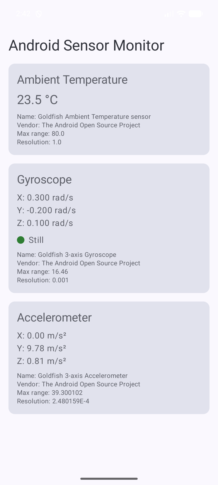

# ca.gbc.labex6 — COMP3074 LabEx 6: Sensors

**Author:** Mjd Arow

An Android app (Kotlin + Jetpack Compose) that reads device sensors with `SensorManager` and shows live readings.

## Features

### Required
- Jetpack Compose UI titled **Android Sensor Monitor** (Scaffold + scrollable Column).
- **Ambient temperature** (`TYPE_AMBIENT_TEMPERATURE`) shown in °C, with clear messages when the sensor is missing or no reading has arrived yet. No battery-temperature fallback.
- **Gyroscope** (`TYPE_GYROSCOPE`) X/Y/Z angular velocity in rad/s.
- Live updates through `mutableStateOf` state.
- Listeners registered in `onResume()` (`SENSOR_DELAY_NORMAL`, only for sensors that exist) and unregistered in `onPause()`.
- Missing sensors are handled without crashing. No permissions needed.

### Part 18 extensions
- **Third sensor:** accelerometer (`TYPE_ACCELEROMETER`) X/Y/Z in m/s².
- **Movement indicator:** the gyroscope card has a dot that turns red with "Rotating" when √(x²+y²+z²) > 1.0 rad/s, and green with "Still" otherwise.
- **Sensor details:** each available sensor shows its name, vendor, maximum range and resolution.
- **Reusable `SensorValueCard`:** every sensor card uses the same composable.

## Test device

| Item | Value |
|---|---|
| Device | Android Emulator |
| AVD name | Pixel_7 |
| Android version | 17 |
| API level | 37 |
| Ambient temperature sensor available | Yes |
| Gyroscope available | Yes |
| Accelerometer available | Yes |

## Screenshot

## Reflection questions

**1. Why must `getDefaultSensor()` be treated as potentially returning null?**
Android devices don't have to include every sensor. If the hardware isn't there, `getDefaultSensor()` returns `null`. Using that result without a check would crash the app, so the app stores it as `Sensor?` and only registers or shows data when it isn't null.

**2. Why should sensor listeners be unregistered when the activity is paused?**
A registered listener keeps the sensor powered and sends callbacks even when the user can't see the screen. That wastes battery and CPU. Unregistering in `onPause()` and registering again in `onResume()` means the app only listens while it's in the foreground.

**3. What is the difference between gyroscope angular velocity and device orientation?**
The gyroscope measures how fast the device is rotating around each axis right now. Orientation is the angle the device is held at. A phone held still at any tilt reads about 0 rad/s on the gyroscope. To get orientation from the gyroscope you'd have to integrate its values over time, or use the rotation-vector / accelerometer + magnetometer sensors.

**4. What units are used for the gyroscope values in this lab?**
Radians per second (rad/s) for X, Y and Z.

**5. Why is battery temperature not a valid replacement for `TYPE_AMBIENT_TEMPERATURE`?**
Battery temperature measures the battery, which heats up from charging, the CPU and the user's hand. It doesn't measure the surrounding air, so showing it as ambient temperature would be wrong.

**6. How does `mutableStateOf` allow a `SensorEvent` callback to update the Compose UI?**
`mutableStateOf` creates observable state. Composables that read the value during composition subscribe to it. When `onSensorChanged()` writes a new value, Compose marks those composables invalid and recomposes them with the new reading. No manual UI refresh is needed.
